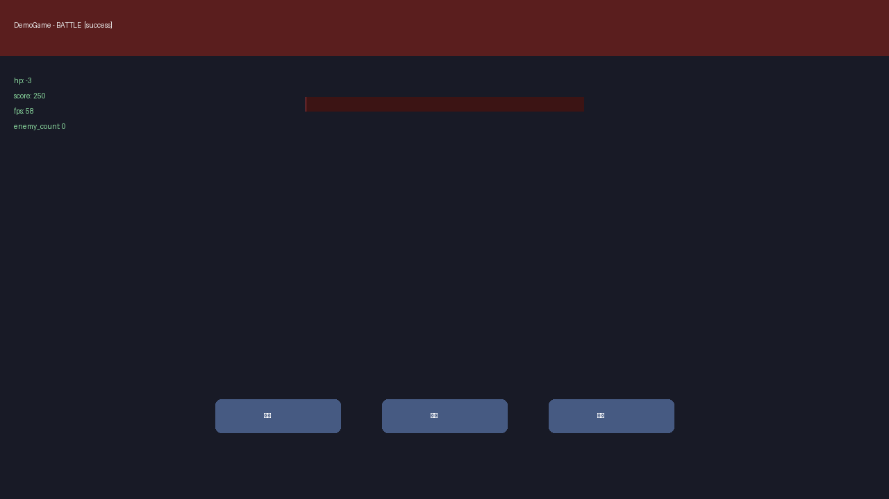
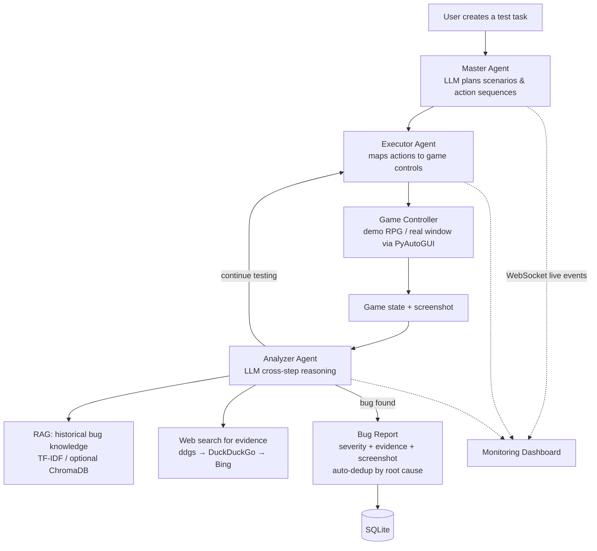
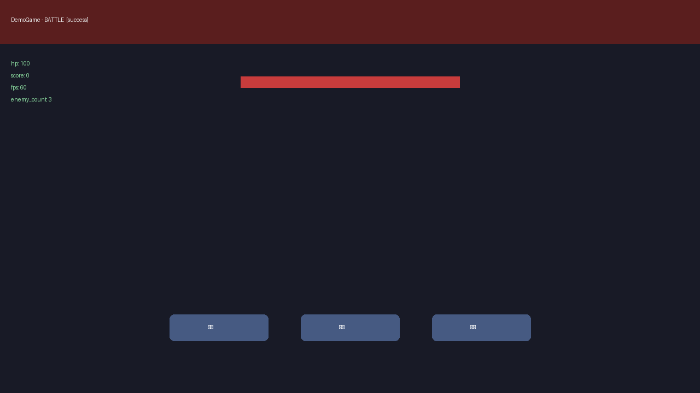

<div align="center">

# 🎮 Game Test Agent

**An LLM-powered multi-agent system that autonomously plays games, finds bugs, and writes evidence-backed bug reports.**


[](CONTRIBUTING.md)

**English** | [简体中文](README.zh-CN.md)



*The analyzer agent caught a planted bug: HP dropped to **-3** after a sudden 78-point damage spike (historical damage: 5 / 11 / 9).*

</div>

---

## 💡 What is this?

Game Test Agent lets LLM agents **do the work of a game QA tester**: a master agent plans test scenarios, an executor agent actually operates the game, and an analyzer agent reasons over cross-step game state to decide whether something is a bug — then produces a structured bug report with severity, reasoning, knowledge-base citations, web evidence, and screenshots.

It ships with a **built-in demo RPG containing 3 planted bugs**, so you can watch the full loop run end-to-end without owning any real game. Switch one config flag and it controls a **real game window** via PyAutoGUI instead.

## ✨ Features

| Capability | Description |
|---|---|
| 🧠 **Multi-agent collaboration** | Master agent (plans test paths) → Executor agent (operates the game) → Analyzer agent (judges bugs) |
| 🔍 **Cross-step reasoning** | The analyzer compares state across steps — e.g. *"historical damage 5/11/9, this step dropped 78 HP and HP went negative"* — and outputs its full reasoning |
| 🌐 **Web search for evidence** | When uncertain, the analyzer searches the internet (ddgs → DuckDuckGo HTML → Bing, three-level fallback, **no API key needed**) |
| 📚 **RAG knowledge base** | Historical bug knowledge enhances judgments (zero-dependency TF-IDF + bigram retrieval out of the box; auto-upgrades to ChromaDB vector search when installed) |
| 🎮 **Dual game modes** | `demo`: built-in simulated RPG with planted bugs, runs out of the box · `window`: control a real game window with PyAutoGUI |
| 📡 **Live monitoring** | WebSocket pushes every execution / analysis / bug event to the dashboard in real time |
| 🐛 **Structured bug reports** | Title / severity / category / expected / actual / reasoning / screenshot, with automatic same-root-cause deduplication |

## 🏗️ Architecture



The workflow (`plan → execute → analyze → bug? → … → finish`) runs on a **lightweight self-built StateGraph engine** (`app/workflow/engine.py`) that implements LangGraph-style nodes / edges / conditional edges semantics without pulling in heavy langchain/langgraph dependencies.

## 🚀 Quick Start

> Requires **Python 3.11+** and an API key for any **OpenAI-compatible** LLM endpoint (SiliconFlow, OpenAI, DeepSeek, a local vLLM/Ollama server, …). No real game is needed — demo mode works out of the box.

```bash
cd backend

# 1. Install dependencies
python -m venv .venv
source .venv/bin/activate        # Windows: .venv\Scripts\activate
pip install -r requirements.txt

# 2. Configure (copy the template, then fill in your API key)
cp .env.example .env             # Windows: copy .env.example .env

# 3. Initialize database + sample knowledge base
python scripts/init_db.py

# 4. Launch
python -m uvicorn main:app --host 127.0.0.1 --port 8000
```

Open **http://127.0.0.1:8000** → create a task → click **▶ Start Test** → watch the agents test the game live.

- API docs: http://127.0.0.1:8000/docs
- **Windows one-click**: double-click `一键启动.bat` in the repo root (auto-installs dependencies, initializes the DB, starts the server minimized, and opens the dashboard). `一键关闭.bat` stops everything.

## 📸 Demo: agents finding a planted bug

| Battle start (HP 100) | Bug caught (HP **-3**) |
|---|---|
|  |  |

Verified end-to-end run (12 steps, demo mode):

- ✅ Master agent autonomously planned the path *"login flow → battle loop → inventory & equipment boundaries → settings boundaries"*
- ✅ Analyzer agent detected the planted bug via **cross-step numeric comparison**: *"historical damage 5/11/9, this step dropped 78 HP and HP = -3"*
- ✅ RAG hit a knowledge-base case and cited it in the verdict: *"negative HP is a numeric-overflow bug; root cause is a damage formula without a lower-bound clamp"*
- ✅ Every step streamed over WebSocket; duplicate bugs were merged automatically

## ⚙️ Configuration

Copy `backend/.env.example` to `backend/.env`:

| Key | Description | Default |
|---|---|---|
| `LLM_API_KEY` | Your OpenAI-compatible API key | — |
| `LLM_BASE_URL` | OpenAI-compatible endpoint | `https://api.siliconflow.cn/v1` |
| `LLM_MODEL` | Model ID | `deepseek-ai/DeepSeek-V4-Flash` |
| `GAME_MODE` | `demo` (simulated game) / `window` (real window) | `demo` |
| `GAME_WINDOW_TITLE` | Target window title for `window` mode | — |
| `MAX_STEPS` | Max test steps per task | `12` |
| `WEB_SEARCH_ENABLED` | Analyzer searches the web when unsure | `true` |

### 🎮 Testing a real game

```ini
GAME_MODE=window
GAME_WINDOW_TITLE=Your Game Window Title
```

Then `pip install pyautogui`. The executor agent maps planned actions to screen coordinates and controls the window; screenshots are captured each step for the analyzer.

## 📁 Project Structure

```
backend/
├── main.py                    # FastAPI entry (REST + WebSocket + static dashboard)
├── scripts/init_db.py         # Schema + sample knowledge base
├── static/index.html          # Zero-build monitoring dashboard (served by FastAPI)
└── app/
    ├── config.py              # Env-driven settings
    ├── llm.py                 # OpenAI-compatible client (rate limiting, 429 backoff, reasoning_content)
    ├── models/                # Task / BugReport / TestLog / KnowledgeBase
    ├── agents/
    │   ├── master_agent.py    # Plans test scenarios & action sequences
    │   ├── executor_agent.py  # Actions → coordinates → game control
    │   └── analyzer_agent.py  # Bug judgment + RAG + web evidence
    ├── automation/
    │   ├── demo_game.py       # Built-in RPG with 3 planted bugs (HP overflow / dead click / NaN display)
    │   ├── game_controller.py # demo / window dual-mode controller
    │   └── screen_capture.py  # Screenshots
    ├── rag/retriever.py       # TF-IDF + bigram retrieval, optional ChromaDB
    ├── tools/web_search.py    # ddgs → DuckDuckGo HTML → Bing fallback
    ├── workflow/
    │   ├── engine.py          # Lightweight StateGraph (LangGraph-equivalent semantics)
    │   └── test_workflow.py   # plan → execute → analyze → (bug?) → … → finish
    ├── services/task_service.py
    └── api/                   # /api/tasks /api/bugs /api/knowledge /ws/{task_id}
```

## 🛠️ Engineering Highlights

1. **Reliable LLM integration** — global rate-limited serialization, exponential backoff on 429, and `reasoning_content` compatibility for thinking models.
2. **Internet evidence for the analyzer** — three-level search fallback so it works on restricted networks without any search API key.
3. **RAG that runs anywhere** — zero-dependency lightweight retrieval by default; installing `chromadb` automatically upgrades to vector search.
4. **Demo mode** — a simulated RPG with 3 planted bug classes makes the whole loop demonstrable without a real game.
5. **Bug deduplication** — same-root-cause bugs merge their evidence instead of flooding the report list.
6. **Zero-build frontend** — a single-file static dashboard served directly by FastAPI.
7. **Lightweight workflow engine** — LangGraph-style StateGraph semantics without the heavy dependency tree.

## 🗺️ Roadmap

- [ ] pytest unit tests for the workflow engine and analyzer
- [ ] More planted bug patterns (memory leaks, frame drops, save corruption)
- [ ] Recorded demo GIF / hosted live demo
- [ ] Export bug reports to Markdown / CSV

## 🤝 Contributing

Issues and PRs are welcome! Please open an issue first for major changes.

## 📄 License

[MIT](LICENSE)

## 🙏 Acknowledgments

This project started as a reproduction of a public LLM-Agent development course project and was substantially reworked and extended by the author (see [Engineering Highlights](#-engineering-highlights)). Credit to the original course for the initial concept. Not affiliated with the course author.

<!--
After pushing to GitHub, uncomment and replace <your-username> to show star growth:

[](https://star-history.com/#<your-username>/game-test-agent&Date)
-->
