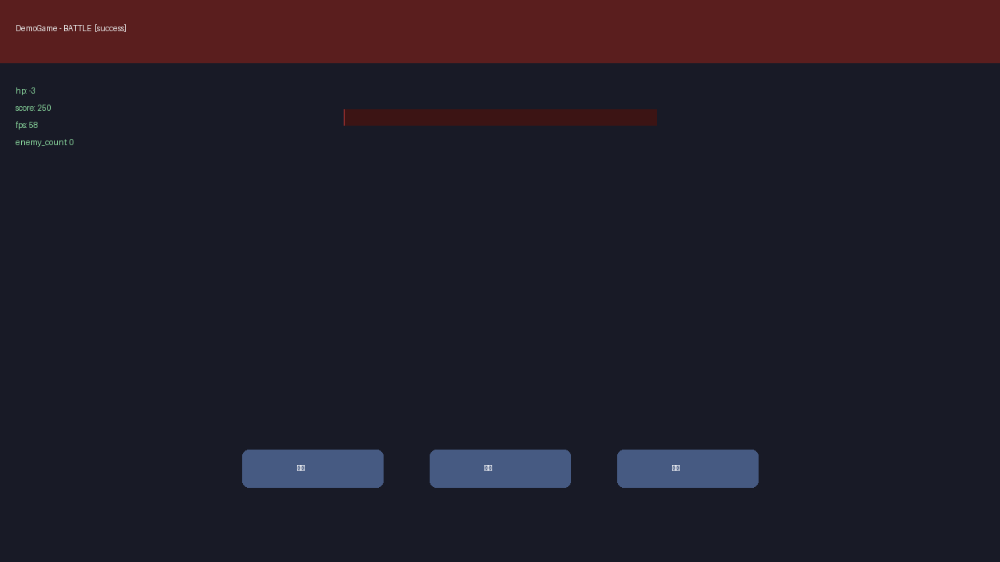
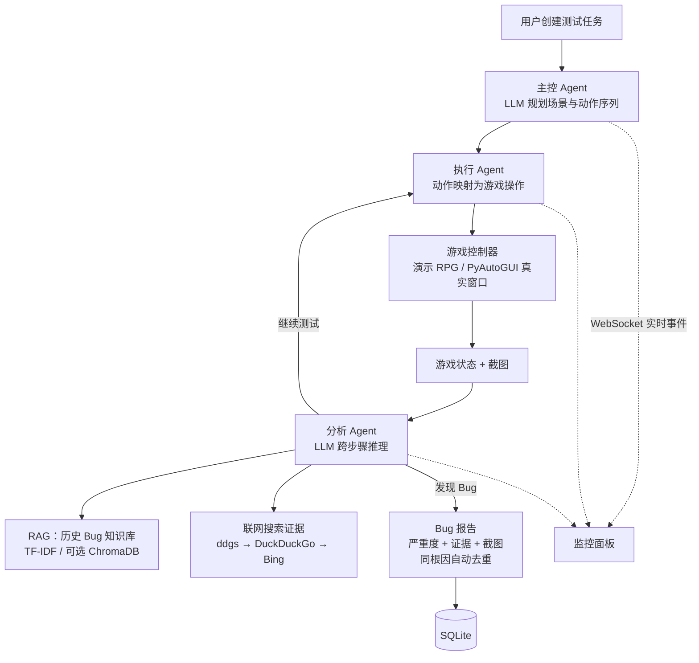
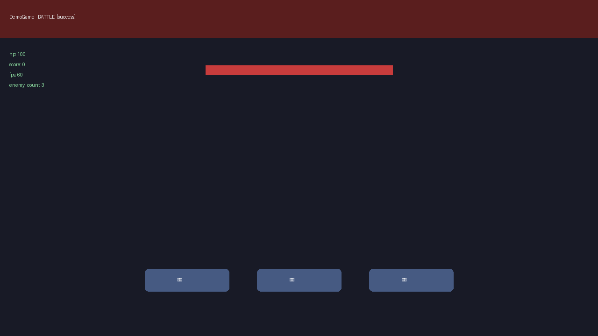

<div align="center">

# 🎮 游戏测试 Agent（Game Test Agent）

**基于 LLM 的多 Agent 系统：自主玩游戏、找 Bug、生成带证据链的 Bug 报告。**


[](CONTRIBUTING.md)

[English](README.md) | **简体中文**



*分析 Agent 抓到预埋 Bug：历史扣血 5 / 11 / 9，本次骤降 78 点，HP 跌至 **-3**。*

</div>

---

## 💡 这是什么？

游戏测试 Agent 让 LLM 智能体**承担游戏 QA 测试员的工作**：主控 Agent 规划测试场景，执行 Agent 实际操控游戏，分析 Agent 对跨步骤游戏状态进行推理判定是否为 Bug——然后产出结构化 Bug 报告（严重度、推理过程、知识库引用、联网证据、截图）。

内置**预埋 3 类 Bug 的演示 RPG**，不需要任何真实游戏即可观看完整闭环；改一个配置项即可切换为通过 PyAutoGUI **控制真实游戏窗口**。

## ✨ 核心能力

| 能力 | 说明 |
|---|---|
| 🧠 **多 Agent 协作** | 主控 Agent（规划测试路径）→ 执行 Agent（操控游戏）→ 分析 Agent（判定 Bug） |
| 🔍 **跨步骤推理** | 分析 Agent 做跨步骤数据对比——如 *"历史扣血 5/11/9，本次骤降 78 点且 HP 为负"*——并输出完整推理 |
| 🌐 **联网搜索证据** | 判定存疑时自动搜索互联网资料（ddgs → DuckDuckGo HTML → Bing 三级降级，**无需搜索 API Key**） |
| 📚 **RAG 知识库** | 历史 Bug 知识增强判定（零依赖 TF-IDF + bigram 检索开箱即用；安装 ChromaDB 后自动升级向量检索） |
| 🎮 **双游戏模式** | `demo`：内置模拟游戏（预埋 Bug，开箱即跑）· `window`：PyAutoGUI 控制真实游戏窗口 |
| 📡 **实时监控** | WebSocket 推送每一步执行 / 分析 / Bug 事件到控制台面板 |
| 🐛 **结构化 Bug 报告** | 标题 / 严重度 / 分类 / 预期 / 实际 / 判定依据 / 截图，同根因自动去重合并 |

## 🏗️ 架构



工作流（`plan → execute → analyze → bug? → … → finish`）运行在**自研轻量 StateGraph 引擎**（`app/workflow/engine.py`）上，实现 LangGraph 风格的节点 / 边 / 条件边语义，不引入 langchain/langgraph 重依赖。

## 🚀 快速开始

> 需要 **Python 3.11+** 和任意 **OpenAI 兼容** LLM 接口的 API Key（硅基流动 SiliconFlow、OpenAI、DeepSeek、本地 vLLM/Ollama 等）。无需真实游戏——demo 模式开箱即跑。

```bash
cd backend

# 1. 安装依赖
python -m venv .venv
source .venv/bin/activate        # Windows: .venv\Scripts\activate
pip install -r requirements.txt

# 2. 配置（复制模板后填入你的 API Key）
cp .env.example .env             # Windows: copy .env.example .env

# 3. 初始化数据库 + 示例知识库
python scripts/init_db.py

# 4. 启动
python -m uvicorn main:app --host 127.0.0.1 --port 8000
```

打开 **http://127.0.0.1:8000** → 创建任务 → 点 **▶ 启动测试** → 实时观看 Agent 测试游戏。

- API 文档：http://127.0.0.1:8000/docs
- **Windows 一键启动**：双击仓库根目录的 `一键启动.bat`（自动装依赖 → 初始化数据库 → 最小化启动服务 → 打开面板）；`一键关闭.bat` 停止全部服务。

## 📸 演示：Agent 发现预埋 Bug

| 战斗开局（HP 100） | 抓到 Bug（HP **-3**） |
|---|---|
|  |  |

端到端实测验收（12 步，demo 模式）：

- ✅ 主控 Agent 自主规划出「登录主流程 → 战斗循环 → 背包与装备边界 → 设置边界」路径
- ✅ 分析 Agent 通过**跨步骤数值对比**发现预埋 Bug：*"历史扣血 5/11/9，本次骤降 78 点且 HP=-3"*
- ✅ RAG 命中知识库案例并写入判定依据：*"HP 出现负数属于数值越界类 Bug，根因为减血公式未做下限截断"*
- ✅ 全程 WebSocket 实时推送，重复 Bug 自动去重合并

## ⚙️ 配置说明

复制 `backend/.env.example` 为 `backend/.env`：

| 键 | 说明 | 默认 |
|---|---|---|
| `LLM_API_KEY` | OpenAI 兼容接口 API Key | — |
| `LLM_BASE_URL` | OpenAI 兼容接口地址 | `https://api.siliconflow.cn/v1` |
| `LLM_MODEL` | 模型 ID | `deepseek-ai/DeepSeek-V4-Flash` |
| `GAME_MODE` | `demo` 模拟游戏 / `window` 真实窗口 | `demo` |
| `GAME_WINDOW_TITLE` | `window` 模式的目标窗口标题 | — |
| `MAX_STEPS` | 单任务最大测试步数 | `12` |
| `WEB_SEARCH_ENABLED` | 分析 Agent 存疑时联网搜索 | `true` |

### 🎮 测试真实游戏

```ini
GAME_MODE=window
GAME_WINDOW_TITLE=你的游戏窗口标题
```

然后 `pip install pyautogui`。执行 Agent 将规划动作映射为屏幕坐标操控窗口，每步截图供分析 Agent 判定。

## 📁 项目结构

```
backend/
├── main.py                    # FastAPI 入口（REST + WebSocket + 静态面板）
├── scripts/init_db.py         # 建表 + 示例知识库
├── static/index.html          # 零构建监控面板（FastAPI 直接托管）
└── app/
    ├── config.py              # 环境变量驱动配置
    ├── llm.py                 # OpenAI 兼容客户端（全局限流 / 429 退避 / reasoning_content 兼容）
    ├── models/                # Task / BugReport / TestLog / KnowledgeBase
    ├── agents/
    │   ├── master_agent.py    # 规划测试场景与动作序列
    │   ├── executor_agent.py  # 动作 → 坐标 → 操控游戏
    │   └── analyzer_agent.py  # Bug 判定 + RAG + 联网证据
    ├── automation/
    │   ├── demo_game.py       # 内置 RPG（预埋 3 类 Bug：HP 越界 / 点击无响应 / NaN 显示）
    │   ├── game_controller.py # demo / window 双模式控制器
    │   └── screen_capture.py  # 截图
    ├── rag/retriever.py       # TF-IDF + bigram 检索，可选 ChromaDB
    ├── tools/web_search.py    # ddgs → DuckDuckGo HTML → Bing 三级降级
    ├── workflow/
    │   ├── engine.py          # 轻量 StateGraph（LangGraph 等价语义）
    │   └── test_workflow.py   # plan → execute → analyze → (bug?) → … → finish
    ├── services/task_service.py
    └── api/                   # /api/tasks /api/bugs /api/knowledge /ws/{task_id}
```

## 🛠️ 工程亮点

1. **可靠的 LLM 接入**：全局限流串行 + 429 指数退避重试 + 思考模型 `reasoning_content` 兼容。
2. **分析 Agent 联网证据**：三级搜索降级，受限网络下无需任何搜索 API Key 也能用。
3. **到处能跑的 RAG**：默认零依赖轻量检索；安装 `chromadb` 后自动切换向量检索。
4. **Demo 模式**：预埋 3 类典型 Bug 的模拟 RPG，没有真实游戏也能完整演示闭环。
5. **Bug 去重**：同根因 Bug 自动合并证据，避免报告刷屏。
6. **零构建前端**：单文件静态面板，FastAPI 直接托管。
7. **轻量工作流引擎**：LangGraph 风格 StateGraph 语义，无重依赖。

## 🗺️ 路线图

- [ ] 工作流引擎与分析 Agent 的 pytest 单元测试
- [ ] 更多预埋 Bug 模式（内存泄漏、掉帧、存档损坏）
- [ ] 演示 GIF / 在线 Demo
- [ ] Bug 报告导出 Markdown / CSV

## 🤝 贡献

欢迎 Issue 和 PR！重大改动请先开 Issue 讨论。

## 📄 许可证

[MIT](LICENSE)

## 🙏 致谢

本项目最初复现自一个公开的 LLM-Agent 开发课程项目，随后由作者大幅重构与扩展（见[工程亮点](#-工程亮点)）。感谢原课程提供的初始概念。与课程作者无关联。

<!--
After pushing to GitHub, uncomment and replace <your-username> to show star growth:

[](https://star-history.com/#<your-username>/game-test-agent&Date)
-->
